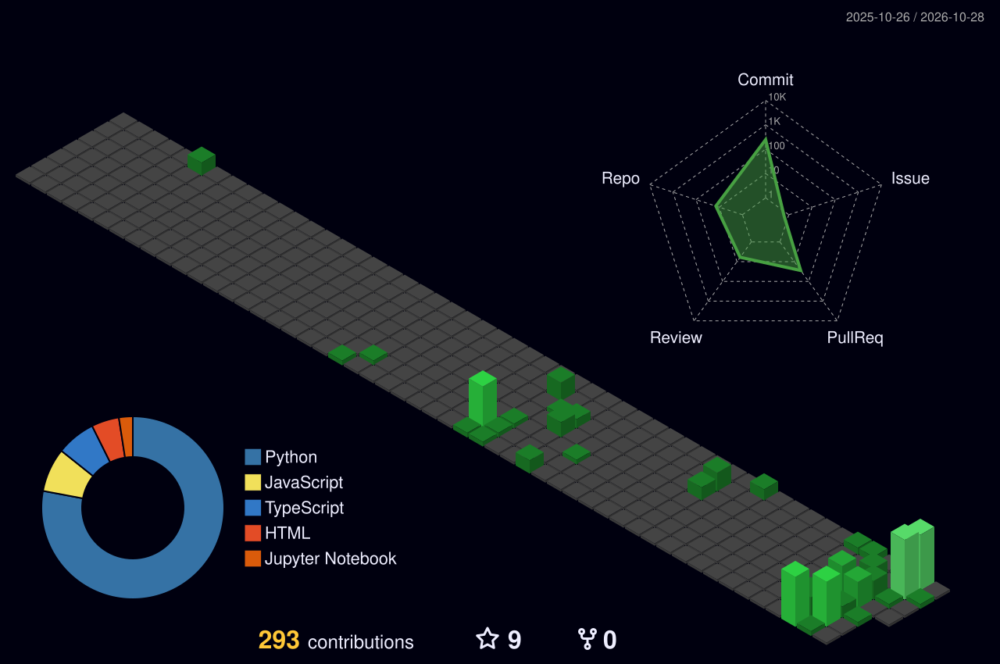

# An Vi

**AI Engineer Intern · Machine Learning · Retrieval & LLM Systems**

Computer Science student at **University of Information Technology (UIT), VNU-HCM**, seeking an AI Engineer internship. I work on retrieval pipelines, machine learning experiments, and AI applications that connect models to usable interfaces.

Ho Chi Minh City, Vietnam · Expected graduation: **2028**

[Portfolio](https://nguyen-vo-an-vi-portfolio.vercel.app) · [Resume (PDF)](https://nguyen-vo-an-vi-portfolio.vercel.app/public/Nguyen_Vo_An_Vi_CV.pdf) · [Email](mailto:anvi23052006@gmail.com) · [LinkedIn](https://www.linkedin.com/in/nguy%E1%BB%85n-vi-264640350/) · [Kaggle](https://www.kaggle.com/barakuga)

## Focus

- **Retrieval & RAG:** Vietnamese knowledge retrieval, embeddings, relevance filtering, and evidence selection for LLM responses.
- **Speech & translation:** bilingual ASR–MT–TTS pipelines, protected-span handling, and verification before speech synthesis.
- **Machine learning:** time-aware validation, regularized models, and reproducible training/inference pipelines.
- **AI engineering:** Python APIs, streaming responses, model integration, and frontend/backend deployment.

## Selected projects

### 01 · UIT-ChatBot — Knowledge Retrieval Assistant

Vietnamese RAG assistant that helps prospective students find information from official UIT sources.

**Role:** AI Engineer in a 3-member team · **Stack:** Python, Gemini, FAISS, FastAPI, Redis, React

- Built a retrieval pipeline over **274 curated chunks from 84 official webpages**, with separate university-wide and department-specific indexes.
- Applied similarity-threshold filtering to limit low-relevance context; implemented rate-limit handling and SSE streaming for interactive responses.
- Integrated the React client with FastAPI and deployed the application using Vercel and Render.

[Source & setup](https://github.com/Vie-is-mee/UIT-ChatBot) · [Demo](https://uit-chat-bot-ilcj.vercel.app/) · [Project background](https://nguyen-vo-an-vi-portfolio.vercel.app/#projects)

### 02 · OneVoice-Lab — Vietnamese–English Speech Translation

Local experiment and demo console for Vietnamese–English speech translation, accepting microphone recordings, audio files, or text.

**Stack:** Python, FastAPI, Transformers, sherpa-onnx, ONNX Runtime, Piper TTS

- Connects **ASR → protected-span shielding → R4 machine translation → restoration → deterministic verification → TTS**, preserving selected names, identifiers, and numerical information through translation.
- Gates synthesized speech on a **SAFE / FLAG** decision: flagged translated content is withheld from automatic TTS. This check does not guarantee overall translation accuracy.
- Exposes stage-by-stage runtime latency and a turn-based microphone workflow: record, stop, translate, verify, then play audio when SAFE.

**Status:** experimental local application; full translation requires private R4 checkpoints supplied separately to authorized reviewers.

[Source & setup](https://github.com/Vie-is-mee/OneVoice-Lab) · [Model provenance](https://github.com/Vie-is-mee/OneVoice-Lab/blob/main/MODEL_PROVENANCE.md) · [Runtime scope](https://github.com/Vie-is-mee/OneVoice-Lab/blob/main/CLAIM_BOUNDARY.md)

### 03 · SolarOpt — Rooftop Solar Design Support

Technical MVP that turns roof images or drawings into editable geometry, simulates sunlight and shading, and proposes panel layouts for preliminary engineering review.

**Stack:** Python, FastAPI, OpenCV, Shapely, OR-Tools, pvlib, SQLite, React, TypeScript

- Combines image processing and optional AI-assisted recognition with **user-confirmed roof geometry**, obstacles, dimensions, and orientation before layout calculation.
- Produces **three layout alternatives** subject to geometric, shading, spacing, and budget constraints; checks layouts and runs **eight error scenarios**.
- Tracks design versions, marks results stale after input changes, and supports recalculation with a preference for retaining suitable panel positions; exports JSON, SVG, and PDF reports.

**Status:** technical MVP for preliminary assessment; field accuracy and construction-ready design are outside the validated scope.

[Source & architecture](https://github.com/Vie-is-mee/SolarOpt) · [Demo](https://solaropt-chi.vercel.app) · [Validation record](https://github.com/Vie-is-mee/SolarOpt/blob/main/docs/MVP_VALIDATION.md)

## Research & competitions

Selected results documented in my [portfolio](https://nguyen-vo-an-vi-portfolio.vercel.app/#research). Rankings below refer to team/system results.

| Work | Contribution | Reported outcome / reference |
| --- | --- | --- |
| **CLEF 2026 CheckThat! — Scientific Source Retrieval** | Co-author; fine-tuning multilingual E5-large and a BGE reranker for cross-lingual scientific retrieval. | Accepted Working Notes paper; official-test **MRR@5 0.594**, rank **15th**. [Paper](https://clef-staging.pages.dev/paper74.pdf) |
| **EXACT 2026** | Contributor in a 4-member team; Qwen3-8B with 4-bit QLoRA, symbolic verification, structured parsing, and fallback routing. | **Top 28 / 180 teams**, Round 2 snapshot. [Leaderboard](https://exact-ijcnn.vercel.app/leaderboard) |
| **Hedge Fund Time-Series Forecasting — Team TIU** | LightGBM pipeline with 3-fold chronological walk-forward validation and regularization. | Reported final standing: **7th / 982 teams (Top 1%)**. [Methodology](https://github.com/Vie-is-mee/Hedge-fund_Time-series-forecasting) · [Leaderboard](https://www.kaggle.com/competitions/ts-forecasting/leaderboard) |

## Technical toolkit

| Area | Tools & methods |
| --- | --- |
| Languages | Python, SQL, C++, JavaScript / TypeScript |
| ML & data | PyTorch, scikit-learn, LightGBM, pandas, Polars |
| Retrieval & LLM | FAISS, dense retrieval, BM25, cross-encoder reranking, Gemini API, PEFT / LoRA |
| Multimodal | Vision-language retrieval, BEiT-3, AutoShot |
| Speech & translation | Transformers, sherpa-onnx, ONNX Runtime, Piper TTS, protected-span verification |
| Application engineering | FastAPI, REST / SSE, React, Git, Vercel, Render |

## Education & contact

**B.Sc. in Computer Science — UIT, VNU-HCM**

September 2024 – Expected 2028

Interested in **AI Engineer internship opportunities** involving retrieval/LLM systems, multimodal AI, or applied machine learning.

**Contact:** [anvi23052006@gmail.com](mailto:anvi23052006@gmail.com) · [LinkedIn](https://www.linkedin.com/in/nguy%E1%BB%85n-vi-264640350/) · [Resume](https://nguyen-vo-an-vi-portfolio.vercel.app/public/Nguyen_Vo_An_Vi_CV.pdf)

GitHub contribution activity

Contribution history provides activity context; project repositories above describe the technical work.

