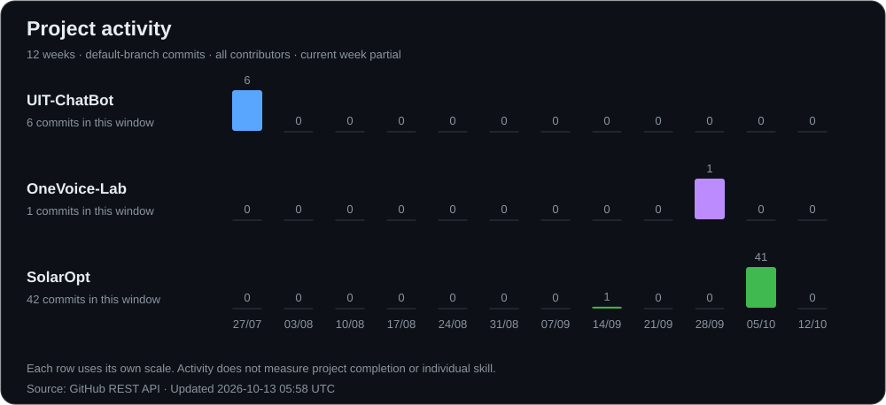
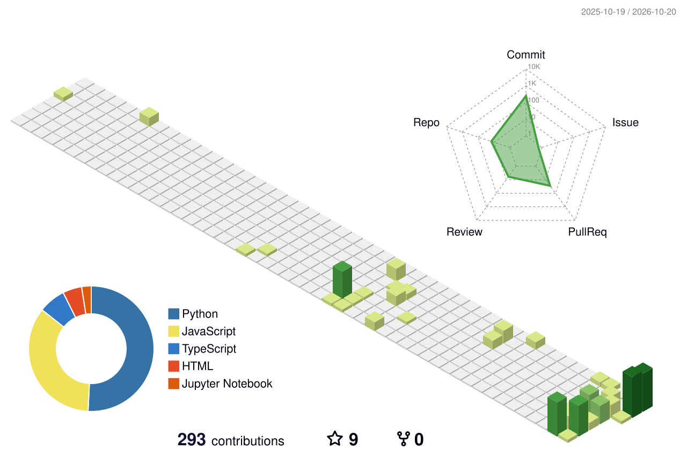



# An Vi

**AI Engineer · Retrieval & RAG · Speech AI · Applied ML**

[Portfolio](https://nguyen-vo-an-vi-portfolio.vercel.app) · [CV](https://nguyen-vo-an-vi-portfolio.vercel.app/public/Nguyen_Vo_An_Vi_CV.pdf) · [LinkedIn](https://www.linkedin.com/in/nguy%E1%BB%85n-vi-264640350/) · [Email](mailto:anvi23052006@gmail.com)

## GitHub at a glance

  
  

  

Public GitHub activity. Language share reflects repository code size; contributions and streaks show activity, not skill ratings. Cards refresh daily; cached snapshots stay visible during provider outages.

## Project activity

| Project | Focus | Explore |
| --- | --- | --- |
| **[UIT-ChatBot](https://github.com/Vie-is-mee/UIT-ChatBot)** | Vietnamese RAG · Gemini · FAISS · FastAPI | [Demo](https://uit-chat-bot-ilcj.vercel.app/) |
| **[OneVoice-Lab](https://github.com/Vie-is-mee/OneVoice-Lab)** | Vietnamese–English ASR → MT → verification → TTS | [Setup & model access](https://github.com/Vie-is-mee/OneVoice-Lab#readme) |
| **[SolarOpt](https://github.com/Vie-is-mee/SolarOpt)** | Roof geometry · shading simulation · panel layout | [Demo](https://solaropt-chi.vercel.app) |

## Contribution landscape

<picture>
  <source media="(prefers-color-scheme: dark)" srcset="./profile-3d-contrib/profile-night-green.svg" />
  <source media="(prefers-color-scheme: light)" srcset="./profile-3d-contrib/profile-green.svg" />
  
</picture>

Automatically updated with GitHub Actions · [How these charts work](./docs/PROFILE_GUIDE.md)
